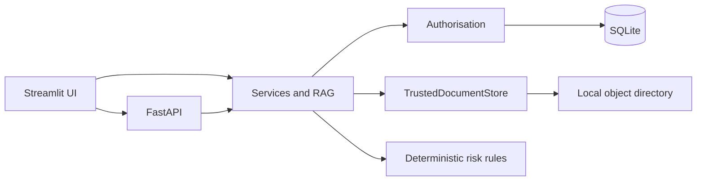

# Architecture

Harbour Meridian Risk Intelligence is a hackathon proof of concept. It is not production-ready and it is not a statement of compliance.

Authorisation runs before structured queries, keyword search, vector search, document viewing, answer generation, report generation and download. A document linked to any customer outside the caller's portfolios is excluded. Empty authorisation is fail-closed.

## Modules

| Path | Responsibility |
| --- | --- |
| `app/domain` | Dates, money, banners, risk formulae, protocols |
| `app/models` | Relational schema shared by SQLite and a future PostgreSQL profile |
| `app/security` | Passwords, HMAC tokens, principal, injection detection |
| `app/authorisation` | Portfolio scope and document visibility |
| `app/audit` | Append-only audit events, with SQLite triggers blocking update and delete |
| `app/ingestion` | Validation, trusted store, parsing and indexing |
| `app/retrieval` | BM25, hashing vectors and feature reranking on an authorised subset |
| `app/rag` | Claims, contradictions, abstention and grounded answers |
| `app/reporting` | Draft HTML, PDF and JSON |
| `app/services` | Search, Customer 360, dashboard and source viewer |
| `app/api` | HTTP API and OpenAPI |
| `app/ui` | Management interface |
| `synthetic_data` | Seeded customers, history and watermarked documents |
| `config` | Taxonomy, score weights, RBAC, freshness and regulatory register |

## Retrieval

The default embedder is a deterministic hashing embedder. No sentence-transformer download and no external LLM is required. `EXTERNAL_LLM_ENABLED` defaults to false. An optional provider boundary exists in `app/llm` and stays disabled.

Current-state questions prefer the latest reporting date among documents that are not superseded. Upload time does not outrank reporting date. Superseded documents remain available for history.

## Calculations

Exposure in HKD is the sum of stored HKD equivalents. Original amounts in different currencies are never added together. The demonstration concern score, probability of default, loss given default and expected loss are Python functions. The composer may explain them. It cannot change the number.

## Evolution path

The document store is a key/value directory so it can later be replaced by an approved object store. The database URL is configuration. Replacing SQLite with PostgreSQL, adding a hosted model, or connecting a bank document repository are production tasks and are not done here. See `docs/production-roadmap.md`.
